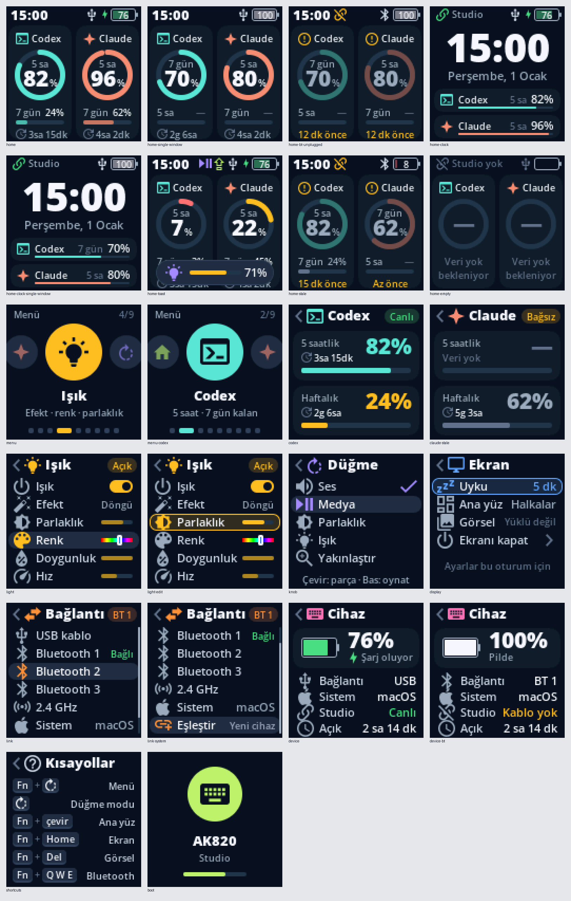

# AK820 Studio

A local macOS companion and custom QMK screen interface for the **AJAZZ AK820 Pro**. The interface is in Turkish. It combines a 128 × 128 color dashboard, knob navigation, keyboard telemetry, and Codex / Claude Code usage adapters.

This is an independent enthusiast project. It is not an official AJAZZ product and is not affiliated with OpenAI or Anthropic.

**[Türkçe kullanım ve durum özeti](docs/README.tr.md)** · **[Studio setup](studio/README.md)** · **[Firmware source and build instructions](firmware/README.md)**



The preview uses illustrative data rendered by the actual C screen code; it is not a live account screenshot.

## What is included

| Component | Current scope |
| --- | --- |
| LCD firmware | Color dashboard, quota rings/bars, clock, icon menu, device and screen settings, knob modes and local lighting controls. |
| Local Studio | Loopback web interface, battery/charging/connection telemetry, screen power and sleep controls. |
| Codex | Finite reads from the locally installed Codex app-server using the existing signed-in account. |
| Claude Code | A quota-only status-line receiver that preserves the previous status-line command. Availability depends on the data supplied by the user's Claude Code setup. |
| Connection management | Connect, disconnect and refresh controls, plus a local CLI. Disconnect stops forwarding; it does not sign out of an account. |
| Image tools | Local PNG/JPEG/WebP/GIF import, crop, adjustments and previews. Stock-firmware transport is retained separately. |

The source snapshot is based on **studio-v3.2**, built and flashed on one AK820 Pro on **11 October 2026**. The recorded flash checksum and live USB bridge were verified then. This public source preparation does not constitute a new hardware test or a claim that every AK820 Pro revision is compatible.

## Current limits

- **QMK image/GIF upload is disabled** in Studio. An experimental implementation is included, but its external-flash write path was not validated on hardware. Local image previews remain available.
- **QMK lighting is controlled from the keyboard's LCD menu.** The desktop QMK RGB adapter deliberately reports unavailable. The stock-firmware RGB path is a separate implementation.
- Live AI data travels over **USB Raw HID**. Bluetooth and the 2.4 GHz receiver do not carry this Studio data channel. Missing or old data is shown explicitly.
- Quota windows depend on the provider/account. A missing window is not zero usage. Claude Code may provide no quota fields; this repository does not fabricate them or start model turns to obtain them.
- Testing was performed on macOS and one keyboard. Windows is unsupported by this host implementation; Linux and other LCD hardware revisions are unverified. Some on-screen route/pairing and host media actions still require hardware-specific verification.

## Quick start

Use Python 3.12 or newer. No credentials belong in this repository.

```sh
cd studio
python3 -m venv .venv
.venv/bin/python -m pip install -r requirements.txt
.venv/bin/python start.py
```

Open [http://127.0.0.1:8765](http://127.0.0.1:8765). After setup, the macOS `AK820 Studio.command` launcher can also start the app. Start with a local preview if no compatible keyboard is attached:

```sh
.venv/bin/python start.py --simulate connected
```

Stop the running Studio instance before switching between simulation and live use. Simulation does not write to a keyboard.

With Studio running, connection management is also available from the terminal:

```sh
.venv/bin/python connect.py all status
.venv/bin/python connect.py codex connect
.venv/bin/python connect.py codex refresh
.venv/bin/python connect.py claude_code connect
.venv/bin/python connect.py claude_code disconnect
```

Read [Studio setup](studio/README.md) before enabling the Claude Code status-line integration. It changes the local status-line command through a wrapper and preserves the existing command and a local backup.

## Firmware and updates

The [`firmware/`](firmware/) directory contains the matching source overlay, pinned upstream reference, build instructions, portable tests, and renderer previews. **Prebuilt firmware, vendor installers, flash dumps and flashing executables are not distributed here.**

On the tested custom firmware, **Fn + Esc** enters the bootloader. Normal QMK USB identity is `0c45:8009` (revision `0100`); bootloader identity is `0c45:7140`. Firmware flashing replaces device code. Follow the [firmware guide](firmware/README.md), confirm the exact hardware and image, and verify the result. The original stock rollback image for the tested unit was not established; do not treat a random vendor BIN as a recovery backup.

## Source layout

```text
studio/       Python server, web UI, host transports, adapters and tests
firmware/     studio-v3.2 source overlay, patch, build metadata and tests
docs/         Usage, publication scope and verification notes
```

Runtime uploads, account usage snapshots, status-line backups and logs stay in local `work/` directories and are ignored by Git. The public repository was prepared from a clean allowlist; the original development workspace was retained.

## Validation

```sh
cd studio
.venv/bin/python -m unittest discover -s tests -v
```

Firmware tests run without a keyboard; see the firmware guide. Read [publication validation](docs/VALIDATION.md) for the checks performed on this copy and their limits.

## License and attribution

Project-authored source is distributed under **GPL-3.0-or-later**; existing file-level notices and third-party asset licenses remain applicable. See [LICENSE](LICENSE) and [THIRD_PARTY.md](THIRD_PARTY.md). QMK, ChibiOS, Open Sans and icon/font contributors retain their copyrights.
